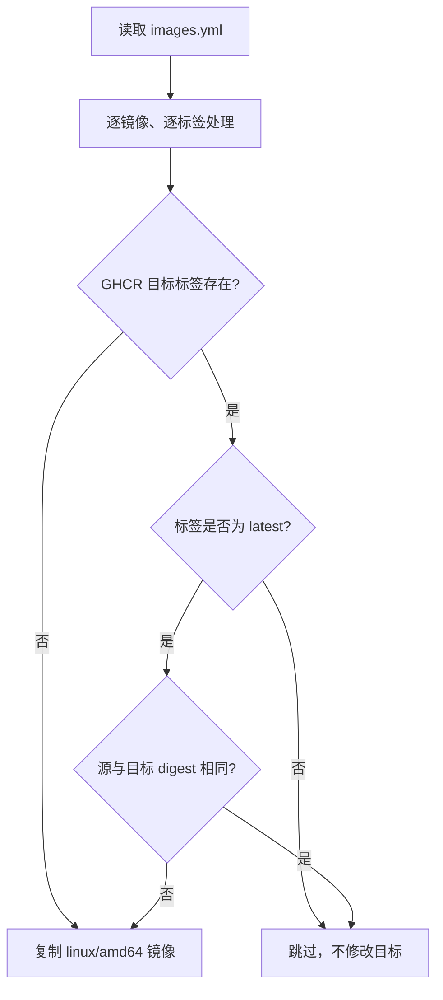

# 🐳 Docker Images Sync

[](https://github.com/tellcts/docker-images-sync/actions/workflows/sync-images.yml)
[](LICENSE)
[](https://github.com/tellcts/docker-images-sync)

一个轻量、可复现的 **Docker Hub → GitHub Container Registry** 镜像同步模板。

项目通过 GitHub Actions 和 [Skopeo](https://github.com/containers/skopeo) 按配置增量同步镜像到 GHCR，适合个人开发、家庭实验室和团队内部加速常用镜像拉取。

> [!IMPORTANT]
> 当前仅同步 `linux/amd64` 镜像。使用 `linux/arm64` 的设备无法从本项目新建的固定标签中拉取匹配架构。

<a id="usage-modes"></a>
## 🚏 两种使用方式

你可以直接使用作者已同步的镜像，也可以 Fork 本项目并同步到自己的 GHCR。

| 使用方式 | 镜像地址 | 适合场景 |
| --- | --- | --- |
| 直接使用作者镜像 | `ghcr.io/tellcts/<name>:<tag>` | 想立即使用，不维护 Actions |
| 自行同步 | `ghcr.io/<your-owner>/<name>:<tag>` | 需要独立存储、权限和更新控制 |

### ⚡ 直接使用作者镜像

如果对应 GHCR Package 已公开，可以直接拉取：

```bash
docker pull ghcr.io/tellcts/nginx:1.30.5
docker pull ghcr.io/tellcts/postgres:18.6
```

作者维护的镜像没有可用性 SLA，标签列表可能随 [`images.yml`](images.yml) 调整。匿名拉取失败时，Package 可能尚未公开，或者需要登录 GHCR。

生产环境或需要长期稳定版本时，更推荐自行同步。

### 🛠️ 自行同步

Fork 本项目并启用 Actions 后，镜像会同步到你自己的 GHCR：

```text
ghcr.io/<your-owner>/<name>:<tag>
```

你拥有独立的目标 Package、权限、存储和配置，不受作者仓库后续标签调整影响。具体步骤见[快速开始](#quick-start)。

<a id="toc"></a>
## 📚 目录

- [使用方式](#usage-modes)
- [功能](#features)
- [工作原理](#how-it-works)
- [快速开始](#quick-start)
- [同步规则](#sync-rules)
- [使用同步镜像](#use-images)
- [注意事项](#notes)
- [本地运行](#local-run)
- [项目结构](#project-structure)
- [贡献](#contributing)
- [许可与合规](#license)
- [免责声明](#disclaimer)

<a id="features"></a>
## ✨ 功能

- **增量同步**：GHCR 中已存在的固定标签直接跳过，不重复推送或改写元数据。
- **更新 `latest`**：仅当源镜像与 GHCR 的 `linux/amd64` digest 不同时才更新。
- **多标签支持**：同一镜像可同时配置固定版本、稳定标签和 `latest`。
- **失败保护**：查询 GHCR 时遇到网络、鉴权或其他异常会终止任务，不把查询失败误判为镜像不存在。
- **并发保护**：定时任务、推送任务和手动任务不会并行修改同一仓库。
- **无需额外 Secret**：使用 GitHub Actions 自动提供的 `GITHUB_TOKEN` 登录 GHCR。
- **同步前测试**：工作流先运行离线测试，测试失败时不会登录或推送镜像。

本项目负责**复制镜像**，不是镜像构建、漏洞扫描、签名验证或供应链审计工具。

<a id="how-it-works"></a>
## 🧭 工作原理



工作流会：

1. 检出仓库并运行同步逻辑测试。
2. 安装 `yq` 和 `skopeo`。
3. 使用 `GITHUB_TOKEN` 登录 `ghcr.io`。
4. 读取 `images.yml` 并逐个处理镜像标签。
5. 使用 `skopeo copy --preserve-digests --override-os linux --override-arch amd64` 复制缺失或需要更新的镜像。

<a id="quick-start"></a>
## 🚀 快速开始

### 1️⃣ Fork 或导入仓库

Fork 本项目，或在 GitHub 上创建自己的仓库并导入这些文件。

同步目标地址由运行工作流时的仓库所有者决定：

```text
ghcr.io/<owner>/<name>:<tag>
```

例如，`tellcts/docker-images-sync` 同步 `nginx:1.30.5` 后，目标为：

```text
ghcr.io/tellcts/nginx:1.30.5
```

### 2️⃣ 启用 Actions

进入仓库的 **Actions** 页面，确认工作流已启用。

工作流需要以下权限，配置已包含在 `.github/workflows/sync-images.yml` 中：

```yaml
permissions:
  contents: read
  packages: write
```

### 3️⃣ 配置镜像

编辑 [`images.yml`](images.yml)：

```yaml
images:
  - name: nginx
    source: nginx
    tag:
      - "1.30.5"
      - "latest"

  - name: postgres
    source: postgres
    tag: "18.6"
```

字段说明：

| 字段 | 必填 | 说明 |
| --- | --- | --- |
| `name` | 是 | GHCR 中的目标镜像名称，例如 `nginx` |
| `source` | 是 | 源镜像名称，不包含标签或 `docker://` 前缀 |
| `tag` | 是 | 单个标签字符串，或标签字符串列表 |

建议为所有标签加引号，避免 `18.6`、`latest` 等内容被 YAML 或命令解析为其他类型。

### 4️⃣ 运行同步

工作流会在以下时机运行：

| 触发方式 | 时间或条件 |
| --- | --- |
| Push | 推送到 `main` 分支 |
| Schedule | 每天 `07:00 UTC`，即北京时间 `15:00` |
| Manual | 在 Actions 页面手动触发 `Sync Images to GHCR` |

推送对 `images.yml` 的修改到 `main` 后，新增标签会立即进入同步流程。

GitHub 的定时任务不保证精确到分钟。在 Actions 高负载时，定时运行可能延迟。

定时任务只从仓库默认分支运行。公开仓库长期没有活动时，GitHub 可能自动停用定时工作流；重新推送提交或在 Actions 页面手动运行后可恢复。

<a id="sync-rules"></a>
## 📋 同步规则

| 标签类型 | GHCR 状态 | 行为 |
| --- | --- | --- |
| 非 `latest` | 已存在 | 跳过，不查询源镜像 |
| 非 `latest` | 不存在 | 复制 `linux/amd64` |
| `latest` | 不存在 | 复制 `linux/amd64` |
| `latest` | digest 相同 | 跳过 |
| `latest` | digest 不同 | 更新 `linux/amd64` |
| 任意标签 | 查询发生网络或鉴权错误 | 任务失败，不执行复制 |

标签名称必须**完全等于** `latest` 才会触发 digest 比较。`stable`、`main`、`trixie` 等其他移动标签仍按固定标签处理。

<a id="use-images"></a>
## 📦 使用同步镜像

同步完成后，可把原来的 Docker Hub 地址：

```bash
docker pull nginx:1.30.5
```

替换为 GHCR 地址：

```bash
docker pull ghcr.io/tellcts/nginx:1.30.5
```

如果目标 Package 是私有的，拉取前需要登录：

```bash
echo "$GHCR_TOKEN" | docker login ghcr.io -u <github-username> --password-stdin
docker pull ghcr.io/tellcts/nginx:1.30.5
```

推荐使用 GitHub Personal Access Token 或 GitHub Actions 的 `GITHUB_TOKEN`，不要使用账号密码。

<a id="notes"></a>
## ⚠️ 注意事项

### 🖥️ 仅支持 `linux/amd64`

所有新建和更新的标签均为单平台镜像：

```text
linux/amd64
```

这可以减少 CI 时间、网络流量和 GHCR 存储占用，但不适用于 ARM64、Apple Silicon 原生容器或其他架构。

如果 GHCR 中存在由旧版本工作流同步的多架构标签，当前固定标签策略不会自动修改它，仓库可能出现单架构与多架构标签并存的状态。需要统一架构时，应先确认影响，再删除目标标签并重新同步。

### 📌 固定标签不会自动刷新

固定标签只要在 GHCR 中存在就会被跳过。即使上游使用同名标签重新发布了不同内容，本项目也不会自动覆盖。

如需重新同步：

1. 在 GHCR 中删除对应的旧标签。
2. 重新运行工作流。

删除镜像标签是不可逆操作，可能影响正在使用该标签的服务。生产环境应优先使用不可变版本号或 digest，并保留回滚方案。

### 🔐 GHCR Package 可见性

首次同步可能创建新的 GHCR Package。Package 的可见性通常会继承仓库或组织设置，但 GitHub 的默认行为可能发生变化。

同步后请检查：

- Package 是 Public 还是 Private。
- Package 是否与仓库正确关联。
- 匿名拉取是否需要额外配置。
- 组织成员或其他仓库是否有读取权限。

### 🚦 Docker Hub 限流

工作流目前使用匿名方式读取 Docker Hub。同步可能受到 Docker Hub 的限流、镜像暂时不可用或上游标签删除影响。

Docker Hub 的限流策略可能变化，本项目不保证上游拉取始终成功。失败时请查看 Actions 日志中的 `skopeo` 错误。

当前工作流没有配置 Docker Hub 凭据，因此不能直接同步需要登录才能访问的私有 Docker Hub 镜像。

### ⏳ 镜像不是即时更新

镜像仅在 `main` 推送、每日定时或手动触发时同步。GitHub Actions 可能排队，Docker Hub 也可能延迟更新标签。

如果业务需要版本可复现，请使用固定版本或把镜像固定到 digest，不要依赖 `latest`。

### 🗑️ 工作流不会删除镜像

从 `images.yml` 中移除配置不会删除 GHCR 中已有的 Package 或标签。清理旧镜像需要手动操作，并应确认是否有服务仍依赖它们。

### ✅ 同步前测试是强制门禁

工作流会先运行：

```bash
bash tests/sync-images.test.sh
```

测试失败时，安装工具、登录 GHCR 和同步镜像步骤都不会执行。这能防止错误逻辑覆盖现有镜像，也会使 CI 直接显示为失败。

<a id="local-run"></a>
## 🧪 本地运行

需要 Linux 或兼容的 Bash 环境，以及：

- Bash
- `yq`
- `skopeo`

Ubuntu/Debian 可安装：

```bash
sudo apt-get update
sudo apt-get install -y yq skopeo
```

运行离线测试：

```bash
bash tests/sync-images.test.sh
```

测试使用模拟的 `yq` 和 `skopeo`，不会访问 Docker Hub 或 GHCR。

登录 GHCR 并运行真实同步：

```bash
echo "$GHCR_TOKEN" \
  | skopeo login ghcr.io -u <github-username> --password-stdin

REGISTRY=ghcr.io \
OWNER=<github-owner> \
bash scripts/sync-images.sh
```

脚本默认读取当前目录下的 `images.yml`。也可以通过 `IMAGES_FILE` 指定其他文件：

```bash
IMAGES_FILE=/path/to/images.yml bash scripts/sync-images.sh
```

<a id="project-structure"></a>
## 📁 项目结构

```text
.
├── .github/workflows/sync-images.yml  # GitHub Actions 工作流
├── images.yml                         # 镜像同步配置
├── scripts/sync-images.sh             # 同步逻辑
├── tests/sync-images.test.sh          # 离线行为测试
├── LICENSE                            # MIT License
└── README.md
```

<a id="contributing"></a>
## 🤝 贡献

欢迎提交 Issue 和 Pull Request。

- 修改同步逻辑时，请同时补充或更新测试。
- 提交前运行 `bash tests/sync-images.test.sh`。
- 请保持改动聚焦，避免把无关功能混入同一个 PR。
- 不要在配置中加入无权复制、分发或公开的私有镜像和受限镜像。

<a id="license"></a>
## ⚖️ 许可与合规

### 📄 本项目代码

本仓库中的源代码和文档采用 [MIT License](LICENSE)。

你可以复制、修改、分发或商业使用本项目代码，但必须保留原始版权声明和许可证文本。

### 🖼️ 同步的镜像

**MIT License 仅适用于本仓库，不适用于通过本项目同步的任何上游镜像。**

每个镜像仍受其原始许可证、服务条款、商标政策、出口管制和再分发规则约束，包括：

- 镜像内包含的软件和资源。
- 镜像维护者发布的许可证或商业使用限制。
- Docker Hub 和 GHCR 各自的服务条款。
- 镜像名称、Logo 和相关项目的商标权。

同步到 GHCR 不会改变镜像的许可证，也不表示镜像可以无条件公开再分发。请在配置和发布镜像前确认上游许可；对敏感、专有或商业受限镜像，优先使用私有 GHCR Package，并限制访问权限。

### 🧰 第三方工具

- [Skopeo](https://github.com/containers/skopeo) 遵循其自身许可证。
- [GitHub Actions](https://docs.github.com/actions) 受 GitHub 服务条款约束。
- Docker 和 Docker Hub 是 Docker, Inc. 的商标。
- GitHub 和 GitHub Container Registry 是 GitHub, Inc. 的商标。

本项目与 Docker, Inc.、GitHub, Inc. 及各镜像维护者没有隶属或背书关系。

<a id="disclaimer"></a>
## 🛡️ 免责声明

本项目按“现状”提供，不附带任何明示或暗示担保。

镜像同步成功不代表镜像安全、合法、无漏洞或适合生产环境。你需要自行评估上游来源、软件供应链、许可证和访问控制。因使用本项目造成的镜像覆盖、服务中断、数据损失或其他风险，由使用者自行承担。

---

如果这个项目对你有帮助，欢迎 Star 和分享。
